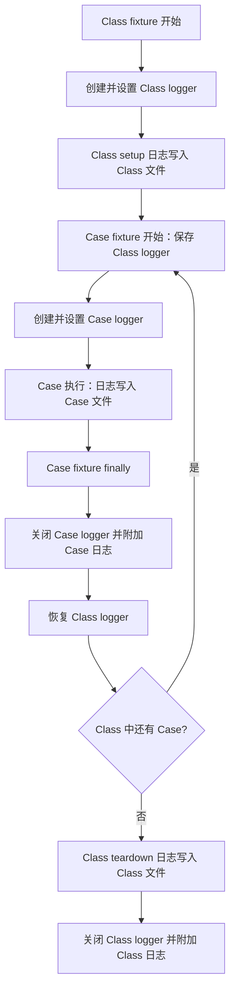
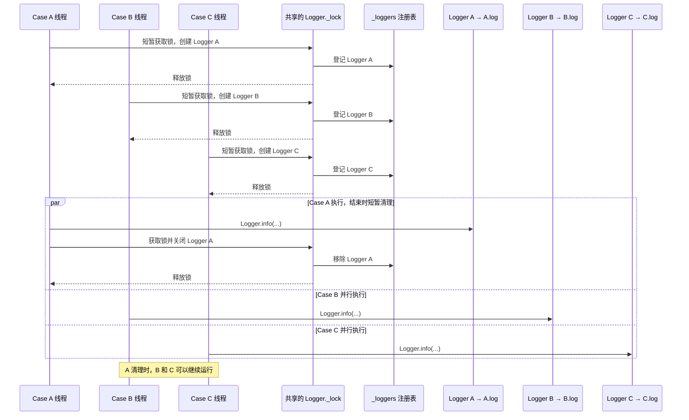

# Logger 与 Case 日志设计

本文记录 `src/utils/logger.py` 和 `tests/conftest.py` 的职责、每个 Case 的日志生命周期，以及关于并行运行和锁的设计讨论。

## 目标

每个 pytest Case 都有自己的日志文件，并在该 Case 的 Allure 结果中附上对应日志。Class 初始化、清理或没有 Case 上下文时产生的日志写入对应 Class 日志，并在 Class fixture 结束后附加到 Allure。多个 Case 并行时，日志也不能写入彼此的文件。

## 两层 Logger

项目里的 `Logger` 是对 Python 标准库 `logging` 的管理封装；实际记录和分发日志的是标准库的 `logging.Logger` 对象。

- `Logger.get_logger(...)` 创建或获取一个标准库 logger，并配置文件、控制台等 handler。
- `_loggers` 是本封装维护的注册表，保存 `logger 名称 -> logging.Logger 对象`，不保存日志文本。
- handler 是日志输出目的地。本项目使用 `RotatingFileHandler` 写文件，也可使用 `StreamHandler` 输出到控制台。
- formatter 控制每条日志的格式；`propagate=False` 可避免继续传递到上级 logger 而重复输出。

业务代码可以用 `Logger.info(...)`、`Logger.error(...)` 等简写。它们会取得当前线程绑定的标准库 logger，再调用对应级别的方法。

## 每个 Case 的生命周期

`tests/conftest.py` 中的 `create_browser` 是 class-scope 的 autouse fixture，`setup_test_logger` 是 function-scope 的 autouse fixture。Class fixture 先创建并设置 Class logger；每个 Case fixture 保存当前 logger（通常是 Class logger），再临时切换到 Case logger。Case 结束时关闭 Case logger、附加 Case 日志，并恢复此前的 Class logger。Class fixture 完成浏览器清理后，关闭 Class logger 并附加 Class 日志。

Logger 上下文按嵌套层级恢复：

```text
Class fixture 开始：保存原来的 logger → 切换到 Class logger
Case fixture 开始：保存 Class logger → 切换到 Case logger
Case 结束：关闭 Case logger → 恢复 Class logger
Class 结束：关闭浏览器和 Class logger → 恢复原来的 logger
```

如果 Class fixture 开始前没有 logger，上下文恢复后会清空当前 logger；后续日志调用会回退到默认 logger。



关闭文件 handler 后再读取文件，可以让日志写入完成并释放文件资源。Case 和 Class fixture 都用 `finally` 清理 logger；浏览器初始化失败时也会尝试清理资源并附加已生成的 Class 日志。

## 文件名与并行 Case

日志保存在按日期划分的目录下，文件名使用清理后的 Case 名称和 UUID 随机后缀，例如：

```text
logs/20261020/test_login_a1b2c3d4e5f6.log
```

Case 名称会替换 Windows 文件名不允许的字符，并截断到一定长度。随机后缀也用于 logger 名称，例如 `case_a1b2c3d4e5f6`。这样并行执行的 Case 即使同名，也会得到不同 logger 和文件。

Class 日志使用相同规则，文件名以 Class 名和随机后缀组成，例如 `TestDemo_7e8f9a0b1c2d.log`；logger 名称为 `class_7e8f9a0b1c2d`。同一 Class 如果在不同 worker 或不同运行中初始化，也不会共享日志文件。

文件名不包含 worker ID，以减少命名规则和分支。每个 Case 执行实例靠随机后缀区分。

Class 日志只接收当前没有被 Case logger 覆盖时产生的日志，例如浏览器初始化、Case 之间的类级操作和浏览器清理。Case 执行期间的日志只写入 Case 文件，不会重复写入 Class 文件。

浏览器池的创建和关闭状态现在也通过 `Logger.info()` 输出，因此会按当前上下文进入 Class 或 Case 文件。直接调用 `print()` 或绕过 `Logger` 使用其他日志系统的消息，不会自动遵循这套上下文路由；需要纳入文件日志时应改为使用 `Logger`。

## `_lock` 的作用

`Logger._lock` 是 `Logger` 类共享的一把线程锁。它在 `get_logger()` 创建或登记 logger，以及 `close_logger()` 清理 logger 时短暂持有，用来保护 `_loggers` 注册表和“检查后创建”的完整过程。

它**不会**在 Case 执行期间持有，也不会让 Case 排队运行。Case 执行时，`Logger.info()` 通过当前线程中的 logger 写入对应文件，不使用这个类级锁。多个 Case 可以并行执行；它们只可能在创建或关闭 logger 的短暂阶段依次使用同一把锁。

若多个线程同时首次创建相同名称的 logger，没有外层锁时可能都检查到注册表里没有该名称，然后拿到同一个标准库 logger 并重复添加 handler。外层锁能避免重复配置。但如果两个 Case 本应分开却用了相同名称，锁不能替代唯一名称；第二个调用会复用已登记的 logger。因此 Case 隔离靠随机后缀和独立文件名，锁负责共享注册表的线程安全。

该锁只在单个 Python 进程内有效。pytest-xdist 的不同 worker 进程各自拥有独立的锁；每个 Case 的唯一 logger 名和文件名负责避免跨 worker 的日志文件冲突。



## 默认 logger

`Logger.get_current_logger()` 会读取当前线程已设置的 logger；如果没有则返回 `None`，不会创建默认 logger。这个方法用于 Case fixture 暂存并恢复 Class logger。

`Logger.get_logger(name=None)` 会返回当前线程的 logger。如果 Case 和 Class 上下文都没有设置 logger，`_get_current_logger()` 会创建或取得名为 `default` 的 logger。默认 logger 只输出到控制台，不写入 Case 或 Class 日志文件。

Class 日志在 Allure 中作为 class-scope fixture 的 teardown 附件展示，而不是复制成每个 Case 的直接附件。Allure 将 fixture 展示在报告的 fixture 区域；附件归属取决于当前 fixture 生命周期。[Allure Pytest fixtures](https://allurereport.org/docs/pytest/)、[Allure attachments](https://allurereport.org/docs/attachments/)。

`threading.local()` 适合同步线程中的 Case 上下文；同一线程中的多个 asyncio task 会共享它。如果以后需要在同一线程中隔离异步任务，可以考虑 `contextvars`。

## 当前配置与相关方法

- 文件日志使用 `RotatingFileHandler`，默认上限为 5 MiB，保留一个备份。当前按每个 Case 的文字日志不会超过 5 MiB 的假设使用，不把轮转作为设计重点。
- 第一次创建 logger 时注册 `atexit` 清理，作为进程退出时的兜底；Case fixture 的关闭逻辑仍负责及时释放每个 Case 的 handler。
- `close_logger(name)` 关闭并移除该 logger 的 handlers，再从 `_loggers` 注册表删除它。Python logging 内部仍保留 logger 对象；之后重新配置同名 logger 时，它已没有旧 handlers。
- Case logger 生命周期嵌套在 Class logger 生命周期内，因此 Case fixture 必须恢复进入前保存的 logger，不能直接清除；最后一个 Case 结束后，Class fixture 才关闭并附加 Class 日志。
- `get_logger()` 遇到已缓存的同名 logger 时会直接复用，传入的新文件路径或级别不会重新配置它；如果标准库 logger 已有 handlers，也会直接返回。Case 使用唯一名称并在结束时关闭，能避免正常用例生命周期里的旧 handler 复用。
- `assert_error(...)` 先写 ERROR 日志，再抛出 `AssertionError`。
- `allure_step(message)` 当前只是直接调用 `allure.step(message)`，没有用 `with` 包住操作区间；如果需要记录完整的 Allure step，通常应以 `with allure.step(message):` 包围对应操作。
- `cleanup_old_logs(...)` 可清理日志根目录下过期的日期目录；只有调用该方法时才会删除文件夹。

